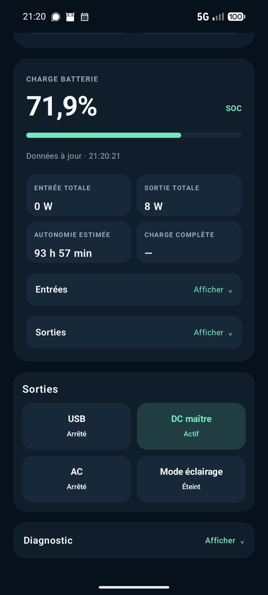
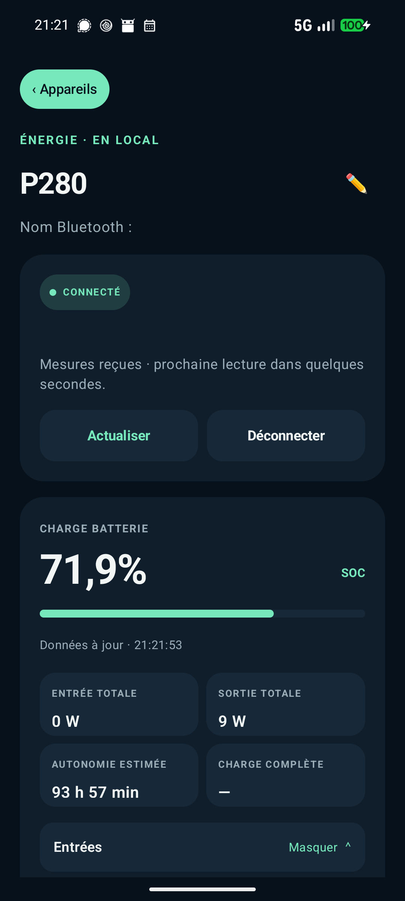
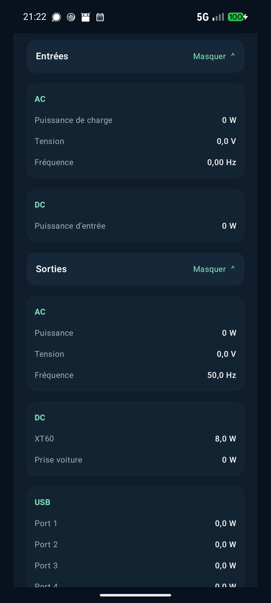
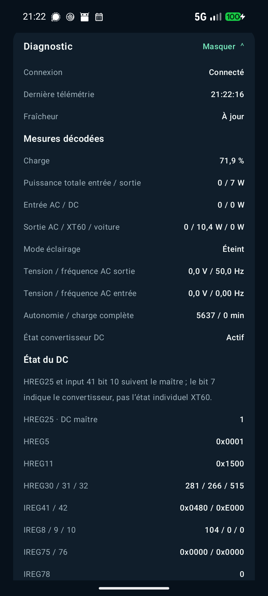

# WattLibre

[English](README.md)

**Contrôle Bluetooth local des stations électriques AFERIY, FOSSiBOT et SYDPOWER.**

Surveillez et contrôlez les stations électriques compatibles AFERIY, FOSSiBOT et SYDPOWER depuis votre téléphone, en Bluetooth local. Aucun compte, service cloud, accès Internet ou service Google Play n’est nécessaire.

[](https://f-droid.org/packages/fr.sudotiz.wattlibre) (bientôt)
[](https://github.com/sudo-Tiz/WattLibre/releases)

## Fonctionnalités

- **Suivre la station** — charge de la batterie, puissance d’entrée et de sortie, autonomie estimée.
- **Contrôler les sorties** — USB, maître DC, AC et quatre modes d’éclairage.
- **Rester connecté** — reconnexion automatique après une coupure et indication lorsque les mesures datent.
- **Personnaliser l’appareil** — choisir un nom local, mémorisé sur ce téléphone.
- **Préserver la confidentialité** — connexion locale, aucune donnée envoyée vers un service cloud.

## Captures d’écran

Les captures montrent l’interface française. Les informations Bluetooth identifiantes sont masquées sur l’écran de connexion.

| Vue d’ensemble | Connexion | Détails entrées/sorties | Diagnostic |
| --- | --- | --- | --- |
|  |  |  |  |

## Démarrage rapide

1. Installez WattLibre depuis [F-Droid](https://f-droid.org/packages/fr.sudotiz.wattlibre) (bientôt) ou [GitHub Releases](https://github.com/sudo-Tiz/WattLibre/releases).
2. Allumez la station et le Bluetooth, puis gardez le téléphone à proximité.
3. Recherchez la station, sélectionnez-la et utilisez les commandes sur sa page.

L’application est conçue pour les stations utilisant un protocole Bluetooth compatible BrightEMS. Elle a été testée avec l’AFERIY P280. La commande maître DC ne coupe **pas** individuellement la sortie XT60.

## Avertissement

WattLibre est fourni **en l’état**, sans garantie. Son utilisation est à vos risques. Les auteurs et contributeurs ne sont pas responsables des dommages liés à son utilisation, notamment d’une station rendue inutilisable (« briquée »).

## Confidentialité et permissions

WattLibre demande les permissions Bluetooth nécessaires à la recherche et à la connexion. Sur Android 11 et antérieur, Android exige aussi la permission de localisation et l’activation du service de localisation pour scanner en Bluetooth; WattLibre n’accède pas aux données de localisation.

L’application ne demande pas l’accès Internet. Les noms personnalisés restent sur ce téléphone.

## Diagnostic

La tuile Diagnostic est facultative et repliée par défaut. Elle contient les mesures détaillées et un bouton pour les copier en cas de problème.

## Pour les développeurs

```sh
./gradlew :app:assembleDebug
```

L’identifiant Android est `fr.sudotiz.wattlibre`. Définissez `versionName` et `versionCode` dans `app/build.gradle.kts`; une nouvelle version poussée sur `main` crée le tag `v<versionName>` et une release GitHub signée. F-Droid compile depuis les sources et signe avec sa propre clé.

## Licence

GPL-3.0-or-later. Référence du protocole BLE : [ESP-FBot](https://github.com/Ylianst/ESP-FBot). WattLibre est un projet indépendant.
