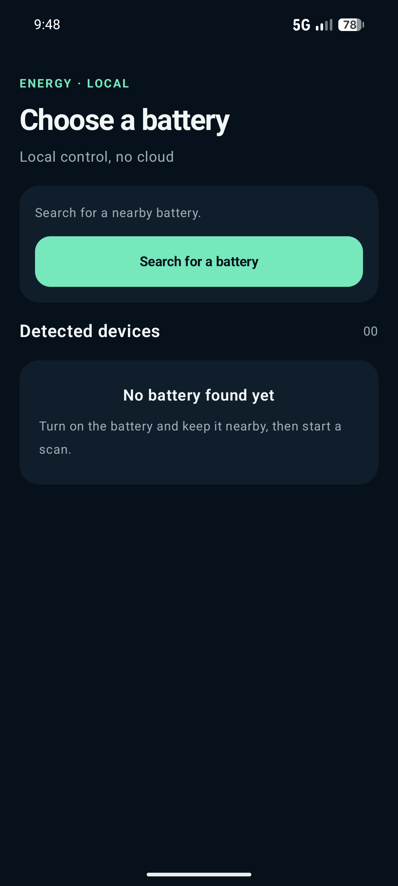
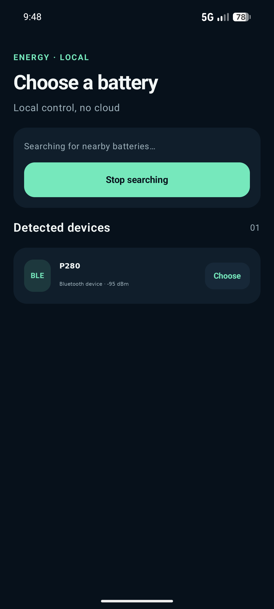
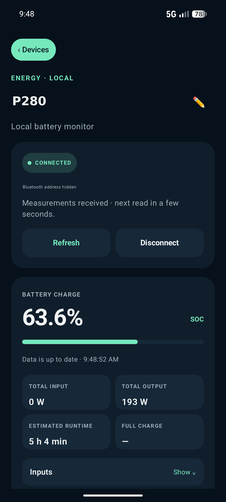
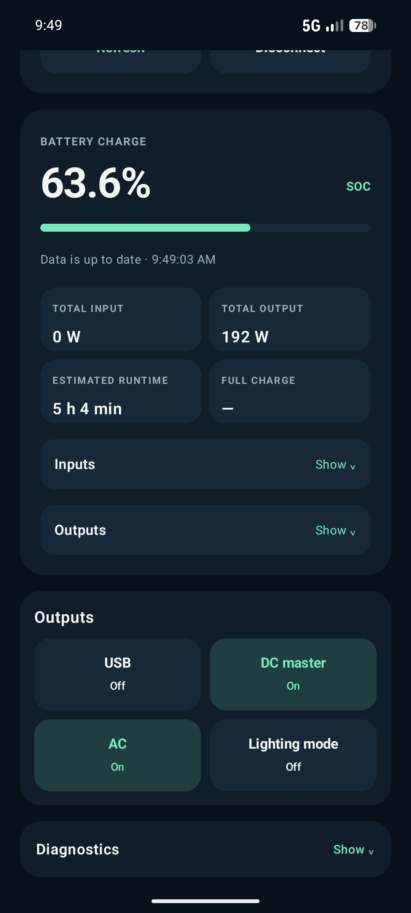
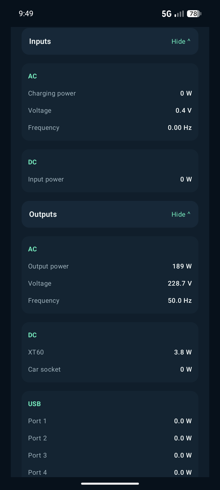
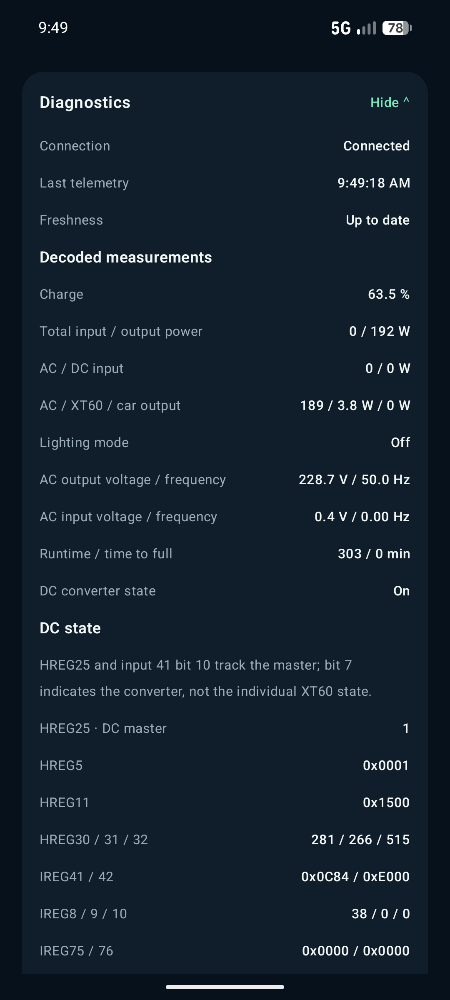

# WattLibre

[Français](README.fr.md)

**Local Bluetooth control for AFERIY, FOSSiBOT and SYDPOWER power stations.**

Monitor and control compatible AFERIY, FOSSiBOT and SYDPOWER power stations from your phone over local Bluetooth. No account, cloud service, Internet permission, or Google Play services.

[](https://f-droid.org/packages/fr.sudotiz.wattlibre)
[](https://github.com/sudo-Tiz/WattLibre/releases)

## Features

- **See what is happening** — battery charge, incoming power, output power, and estimated runtime.
- **Control the station** — USB, DC master, AC, and four lighting modes.
- **Stay connected** — WattLibre retries after a connection drop and marks old readings as stale.
- **Make it yours** — choose a local name for each station; it stays on this phone.
- **Keep it private** — the connection is local and no data is sent to a cloud service.

## Screenshots

These captures show the English interface. Device-specific Bluetooth identifiers are hidden.

| Choose a battery | Scan nearby | Connected station |
| --- | --- | --- |
|  |  |  |
| Overview and controls | Input and output details | Diagnostics |
|  |  |  |

## Quick start

1. Install WattLibre from [F-Droid](https://f-droid.org/packages/fr.sudotiz.wattlibre) or [GitHub Releases](https://github.com/sudo-Tiz/WattLibre/releases).
2. Turn on the power station and Bluetooth, then keep the phone nearby.
3. Scan for the station, select it, and use the controls on its page.

The app is designed for power stations using a BrightEMS-compatible Bluetooth protocol. It has been tested with the AFERIY P280. The DC master control does **not** switch the XT60 output independently.

## Privacy and permissions

WattLibre asks for Bluetooth permissions to find and connect to a station. Android 11 and older also require Location permission and the Location service enabled for Bluetooth scanning; WattLibre does not access location data.

The app has no Internet permission. Custom device names stay on this phone.

## Diagnostics

The optional Diagnostics panel is collapsed by default. It contains detailed readings and a button to copy them when troubleshooting.

## For developers

```sh
./gradlew :app:assembleDebug
```

The Android application ID is `fr.sudotiz.wattlibre`. Set `versionName` and `versionCode` in `app/build.gradle.kts`; a new version on `main` creates a `v<versionName>` tag and a signed GitHub release. F-Droid builds and signs from source with its own key.

## License

GPL-3.0-or-later. BLE protocol reference: [ESP-FBot](https://github.com/Ylianst/ESP-FBot). WattLibre is an independent project.
